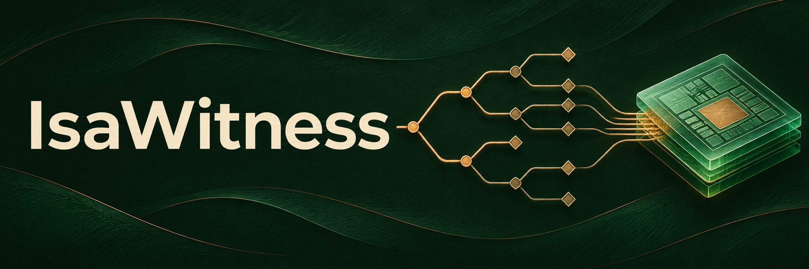

**A Sail-derived Arm model in Lean for downstream machine-code verification.**

A machine-code proof depends on the behavior assigned to each instruction. IsaWitness provides a frozen Sail-derived Arm® model in Lean, reproducible builds, and equations for architectural and event-log observations. The evidence records which selected observations agree with Isla and where comparisons found differences or left gaps.

- Look up any of the 771 instruction forms in the selected inventory. [Instruction inventory](evidence/instruction-inventory.json)
- See where selected observations agree with Isla and where comparisons found differences or left gaps. [Cross-validation evidence](evidence/README.md)
- Rebuild the model from pinned sources and check the canonical hashes of all 1,481 model artifacts. [Build and validation guide](docs/BUILD.md)

The model, observation equations and finite comparisons have distinct scopes. Those boundaries matter for claims about instruction equivalence, constant-time behavior, hardware certification and consumer correctness. [Claims](docs/CLAIMS.md) · [Limitations](docs/LIMITATIONS.md)

A clean source-only fetch and build on GB10 passed all four owned-package axiom gates in about 465 seconds. The final fetch wiring was tested separately against identical Lean source and package configuration. [Source-only measurement](evidence/source-fetch-cold.json) · [Provider status](docs/PROVIDER-STATUS.md)

## Getting started

With Lean 4.35.0 installed, fetch and verify the pinned runtime from your checkout **before** Lake resolves local path dependencies.

```sh
./scripts/fetch-lean-sail
lake update
lake build
```

For full fresh validation, follow [the build instructions](docs/BUILD.md), which gate each owned package and check every model artifact hash. The exact recipe for reproducing the model bit for bit is in [REPRODUCIBILITY](docs/REPRODUCIBILITY.md).

The fetch step needs POSIX `sh`, Git, and one of `sha256sum`, `shasum -a 256`, or `openssl dgst -sha256`. It verifies the exact upstream commit and tree, the ordered patch series, every resulting source/configuration SHA256 and the complete file set. Only `UPSTREAM.json`, patches and the first-party `AbstractReal`/`AbstractRealRat` files are distributed in the runtime directory. Lake still sees the local package ID `lean-sail`. The cold-build entrypoint performs this verified fetch before any Lake update and includes fetch time in the measurement. Package-owned .lake build metadata is outside the source inventory; all extra source/payload files, partial fetches and local edits are refused rather than overwritten.

For a previously obtained Git mirror, use `./scripts/fetch-lean-sail --source /path/to/mirror`; the same commit/tree/file pins remain mandatory. Software Heritage provenance is `swh:1:rev:c816ea7ad03cce98d51acee252540fd4215fede8`, but its read-only revision lookup returned 404 and archive availability is **unconfirmed**. No working archived download or public availability is promised. This fallback is source-only: no prebuilt runtime, model or native cache is redistributed while upstream runtime permissions remain unresolved. Fetch and build locally from source. The clean GB10 measurement took about 465 seconds including fetch (roughly 7.8 minutes); other machines and loads can differ. Cache tooling and candidate archives remain private for later permission review. Run the artifact-reading gate only on your own fresh build outputs, never downloaded or untrusted oleans.

The standard Lake packages under `model/`, `vendor/lean-sail/` and `observers/` use relative dependencies within the materialized checkout. The enclosing Git revision pins the first-party files and overlay metadata; the fetched runtime is pinned by its upstream commit/tree and verified resulting file hashes. The source-only gate implementation is vendored separately from proof modules. Model declarations retain their frozen bytes. The runtime and observer public copies normalize internal labels in comments, with original and public source hashes retained in provenance; their declarations are unchanged.

Generated assertion diagnostics name their source locations by stable relative paths (for example `sail-arm/v8_base.sail:L.C-L.C`). This revision regenerated the 306 affected model modules from the same frozen generator and inputs. Only those 2,244 string literals changed. Every other declaration is kernel-identical to the previous revision.

## Scope and roadmap

This release provides the model semantics and observation equations. Program proofs over those semantics are outside this release. The per-instruction step layer, instruction-class library and generator, value layer, and memory proof layers are under development privately. We plan to release them later with a worked example that goes from machine code to an end-to-end proof. [Current claims](docs/CLAIMS.md) · [Next model revision](NEXT-REVISION.md)

## Related work

- **Islaris** (PLDI 2022) verifies concrete Armv8-A and RISC-V machine code using Isla to generate instruction traces from Sail and an Iris program logic in Coq to reason about them. Its published Arm examples use configurations with address translation turned off, although the underlying ISA model includes translation-table walks. Isla and the SMT solver are in the trusted chain for the basic approach. The paper demonstrates optional validation of traces against Sail-generated Coq semantics for RISC-V. IsaWitness makes the Sail-derived model available directly in Lean and records finite Isla comparisons as validation evidence. [Islaris paper, §§1–2 and 5](https://www.cl.cam.ac.uk/~jp622/islaris.pdf)
- **Sail in Isabelle/HOL and HOL4.** The Sail work presented at POPL 2019 generates Armv8-A theorem-prover definitions for Isabelle/HOL and HOL4. Its Isabelle case study proves a functional characterization of address translation under stated preconditions. IsaWitness brings a frozen Sail-derived Arm model into Lean with a reproducible build and documented observation evidence. [Armstrong et al., POPL 2019, §§4 and 8](https://www.cl.cam.ac.uk/users/pes20/sail/sail-popl2019.pdf)
- **LNSym** provides a Lean symbolic simulator for Armv8 machine code, with its own Arm model, program specifications, proofs, and conformance tests. IsaWitness focuses on making a frozen Sail-derived model and its observation evidence available in Lean. [LNSym repository](https://github.com/leanprover/LNSym#readme)
- **s2n-bignum** verifies concrete arithmetic routines in HOL Light against formal AArch64 and x86-64 machine models. Its documented model scope is sequential, single-core user-mode execution with a flat address space. IsaWitness supplies a Sail-derived model with system-level architectural semantics as a basis for later verification work in Lean. [s2n-bignum repository](https://github.com/awslabs/s2n-bignum#readme) · [Model assumptions](https://github.com/awslabs/s2n-bignum/blob/main/SOUNDNESS.md#b3-what-the-model-omits)

Arm is a registered trademark of Arm Limited (or its subsidiaries or affiliates) in the US and/or elsewhere. This independent project is not sponsored, endorsed or certified by Arm. The public project name is IsaWitness. Canonical Lean package/module identifiers such as `ArmCert` and `ArmFull` remain unchanged for reproducibility.

Apache-2.0 covers first-party material, with copyright held by Crocodile Labs Inc. Third-party terms apply separately. Upstream runtime permissions and patch-distribution rights remain open, and the source preview uses local builds while those questions are unresolved. [License](LICENSE) · [Notice](NOTICE) · [Upstream licensing inquiry](https://github.com/rems-project/lean-sail/issues/24)

The artifact reader is tool-only and outside every proof closure, enforced by the gate. Run the gate on your own fresh builds, not as an auditor of downloaded or untrusted `.olean` files; the reader memory-maps artifact regions using unsafe reads.
