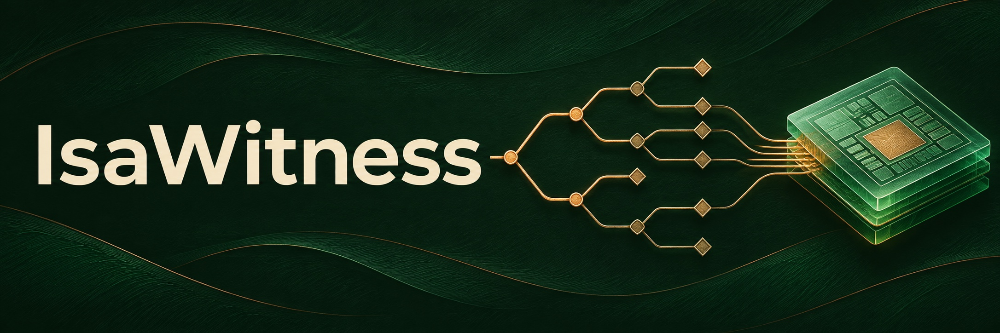

**A Sail-derived Arm model in Lean for downstream machine-code verification.**

A machine-code proof depends on the behavior assigned to each instruction. IsaWitness provides a frozen Sail-derived Arm® model in Lean, reproducible builds, and equations for architectural and event-log observations. The evidence records which selected observations agree with Isla and where comparisons found differences or left gaps.

- Look up any of the 771 instruction forms in the selected inventory. [Instruction inventory](evidence/instruction-inventory.json)
- See where selected observations agree with Isla and where comparisons found differences or left gaps. [Cross-validation evidence](evidence/README.md)
- Rebuild the model from pinned sources and check all 1,571 canonical model and runtime source hashes. [Build and validation guide](docs/BUILD.md)

The model, observation equations and finite comparisons have distinct scopes. Those boundaries matter for claims about instruction equivalence, constant-time behavior, hardware certification and consumer correctness. [Claims](docs/CLAIMS.md) · [Limitations](docs/LIMITATIONS.md)

## Model revision and evidence

IsaWitness pins model revision **v9** at proof commit `83c8f981a6f3c6186784275044845c1ed643cbc1`. The canonical source manifest covers 1,560 `ArmFull` and 11 `Sail` modules. ObsGen provides 771 observation equations in 22 modules. [Model revision](model/REVISION.json) · [Source manifest](model/CANONICAL-SOURCES.sha256)

Isla ran on earlier frozen inputs. The equivalence report and its 12 certified residuals support transfer across the v9 header transition when a fixture is bound to the compared model and retains its original premises and observation. Historical fixture counts keep their original model context. [Equivalence report](evidence/model-equivalence/README.md) · [Cross-validation summary](evidence/cross-validation-summary.json)

## Getting started

With Lean 4.35.0 installed, fetch and verify the pinned runtime from your checkout **before** Lake resolves local path dependencies.

```sh
./scripts/fetch-lean-sail
lake update
lake build
```

For full validation, build and gate all four packages. The validation checks canonical source hashes and requires a complete model and runtime module inventory. [Build and validation guide](docs/BUILD.md) · [Reproduction recipe](docs/REPRODUCIBILITY.md)

The fetch step uses POSIX `sh`, Git and Python 3.11 or later. It verifies the pinned upstream commit and tree, the input files, each edit's source range, and the complete resulting payload. The runtime directory ships the edit recipe, pins, local package configuration and the first-party `AbstractReal` and `AbstractRealRat` sources. A complete existing payload is rechecked on subsequent runs. Partial fetches and local changes cause verification to fail.

Use `./scripts/fetch-lean-sail --source /path/to/mirror` to use a local Git mirror. The same identity checks apply. The upstream Software Heritage ID is `swh:1:rev:c816ea7ad03cce98d51acee252540fd4215fede8`, with archive availability unconfirmed. Compiled runtime, model and native caches stay private pending upstream runtime permission.

## Scope and roadmap

This release provides the model semantics and observation equations. Program proofs over those semantics are outside this release. The per-instruction step layer, instruction-class library and generator, value layer, and memory proof layers are under development privately. We plan to release them later with a worked example that goes from machine code to an end-to-end proof. [Current claims](docs/CLAIMS.md) · [Next model revision](NEXT-REVISION.md)

Signed program claims built on this model are published separately, with the security grades each one holds (CT0 model-trace constant time, CT1 data-independent timing under Arm's DIT contract, CT2 return residue), each as held, FAIL with findings, or not attempted. IsaWitness supplies the model. [Signed releases and grades](https://github.com/CrocSwap/CertiFFI/blob/main/releases/GRADES.md) · [Retired releases](https://github.com/CrocSwap/CertiFFI/blob/main/releases/CHANGELOG.md#superseded)

## Related work

- **Islaris** (PLDI 2022) verifies concrete Armv8-A and RISC-V machine code using Isla to generate instruction traces from Sail and an Iris program logic in Coq to reason about them. Its published Arm examples use configurations with address translation turned off, although the underlying ISA model includes translation-table walks. Isla and the SMT solver are in the trusted chain for the basic approach. The paper demonstrates optional validation of traces against Sail-generated Coq semantics for RISC-V. IsaWitness makes the Sail-derived model available directly in Lean and records finite Isla comparisons as validation evidence. [Islaris paper, §§1–2 and 5](https://www.cl.cam.ac.uk/~jp622/islaris.pdf)
- **Sail in Isabelle/HOL and HOL4.** The Sail work presented at POPL 2019 generates Armv8-A theorem-prover definitions for Isabelle/HOL and HOL4. Its Isabelle case study proves a functional characterization of address translation under stated preconditions. IsaWitness brings a frozen Sail-derived Arm model into Lean with a reproducible build and documented observation evidence. [Armstrong et al., POPL 2019, §§4 and 8](https://www.cl.cam.ac.uk/users/pes20/sail/sail-popl2019.pdf)
- **LNSym** provides a Lean symbolic simulator for Armv8 machine code, with its own Arm model, program specifications, proofs, and conformance tests. IsaWitness focuses on making a frozen Sail-derived model and its observation evidence available in Lean. [LNSym repository](https://github.com/leanprover/LNSym#readme)
- **s2n-bignum** verifies concrete arithmetic routines in HOL Light against formal AArch64 and x86-64 machine models. Its documented model scope is sequential, single-core user-mode execution with a flat address space. IsaWitness supplies a Sail-derived model with system-level architectural semantics as a basis for later verification work in Lean. [s2n-bignum repository](https://github.com/awslabs/s2n-bignum#readme) · [Model assumptions](https://github.com/awslabs/s2n-bignum/blob/main/SOUNDNESS.md#b3-what-the-model-omits)

Arm is a registered trademark of Arm Limited (or its subsidiaries or affiliates) in the US and/or elsewhere. IsaWitness is an independent project. `ArmCert` and `ArmFull` are technical identifiers in the Lean source. Neither identifier denotes Arm sponsorship, endorsement or certification.

Apache-2.0 covers first-party material, with copyright held by Crocodile Labs Inc. Third-party terms apply separately. Upstream runtime permissions remain open. The source preview fetches upstream material and builds it locally. [License](LICENSE) · [Notice](NOTICE) · [Upstream licensing inquiry](https://github.com/rems-project/lean-sail/issues/24)

The artifact reader is tool-only and outside every proof closure, enforced by the gate. Run the gate on your own fresh builds, not as an auditor of downloaded or untrusted `.olean` files; the reader memory-maps artifact regions using unsafe reads.
